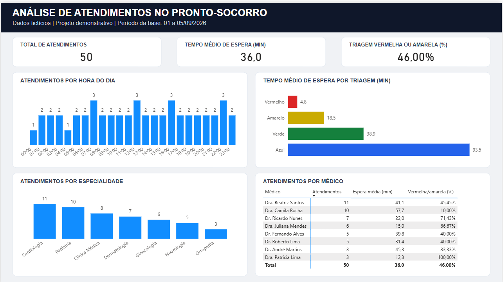

# Análise de atendimentos no pronto-socorro



Meu primeiro projeto em Power BI, desenvolvido para praticar preparação de dados, modelagem e criação de indicadores.

**Autor: Colnilo (Nilo) Lima.**

**Todos os dados são fictícios.** Os nomes de médicos e pacientes, os atendimentos e os resultados não representam uma instituição de saúde real. A base foi preparada para fins de estudo e ajustada ao longo do desenvolvimento do projeto.

## Objetivo

Construí este painel para reunir, em uma única página, o volume de atendimentos e o tempo de espera no pronto-socorro. A análise permite consultar os horários com mais atendimentos, a distribuição por especialidade e as diferenças de espera entre as categorias de triagem. A matriz por médico complementa essa leitura.

O objetivo é descrever os registros da base. Os números não são suficientes para avaliar a qualidade do atendimento ou o desempenho dos profissionais.

## Base de dados

Fonte de trabalho: `Dados-Hospital-Expandido (2).xlsx`.

Período dos registros: **1 a 5 de setembro de 2026**.

| Tabela | Registros | Conteúdo |
|---|---:|---|
| fatendimentos | 50 | Identificador do atendimento, data e hora, paciente, médico, triagem, motivo e espera em minutos |
| dmedicos | 8 | Identificador, nome e especialidade do médico |
| dpacientes | 15 | Identificador, nome, idade, gênero e cidade do paciente |

Cada linha da tabela fato representa um atendimento. Um paciente pode ter mais de um atendimento; portanto, quantidade de atendimentos não significa quantidade de pacientes distintos.

## Preparação e modelo

- Importação das três tabelas do Excel pelo Power Query.
- Tratamento dos tipos de dados, incluindo data e hora do atendimento e espera numérica.
- Criação do campo `Faixa_Hora`, com identificação da hora do dia no formato `HH:00`.
- Organização das medidas na tabela `_Medidas`, sem relacionamento com as demais tabelas.

| Dimensão | Chave | Tabela fato | Cardinalidade e filtro |
|---|---|---|---|
| dmedicos | ID_Medico | fatendimentos[ID_Medico] | Um para muitos; filtro único da dimensão para a fato; ativo |
| dpacientes | ID_Paciente | fatendimentos[ID_Paciente] | Um para muitos; filtro único da dimensão para a fato; ativo |

O escopo atual não utiliza uma dimensão calendário. O gráfico de horários agrega atendimentos da mesma hora ao longo dos cinco dias; ele não representa uma sequência cronológica contínua nem uma média diária. Uma expansão para análises mensais ou inteligência de tempo exigirá rever a modelagem de datas.

## Medidas DAX

Estas são as quatro medidas usadas no painel. Os títulos exibidos no relatório foram ajustados para facilitar a leitura.

```dax
Total Atendimentos =
COUNTROWS(fatendimentos)
```

```dax
Tempo Medio Espera =
AVERAGE(fatendimentos[Tempo_Espera_Minutos])
```

```dax
Total Casos Criticos =
CALCULATE(
    [Total Atendimentos],
    KEEPFILTERS(
        fatendimentos[Cor_Triagem] IN {"Vermelho", "Amarelo"}
    )
)
```

```dax
% Casos Criticos =
DIVIDE(
    COALESCE([Total Casos Criticos], 0),
    [Total Atendimentos]
)
```

Mantive o nome técnico “Casos Criticos” nas medidas, mas o cálculo considera apenas as categorias Vermelho e Amarelo. Por isso, os títulos do painel informam as cores diretamente.

Formatação: contagens inteiras, espera média com uma casa decimal e percentual com duas casas decimais. Em um recorte com atendimentos verdes ou azuis e nenhum vermelho/amarelo, o percentual é zero. Sem atendimentos, os cartões apresentam “Em branco”; isso não equivale a espera zero.

## Relatório

A página **Visão geral** reúne:

1. Total de atendimentos.
2. Tempo médio de espera em minutos.
3. Percentual de triagem vermelha ou amarela.
4. Atendimentos por hora do dia.
5. Espera média por triagem.
6. Atendimentos por especialidade.
7. Matriz por médico com atendimentos, espera média e percentual de triagem vermelha/amarela.

Os gráficos permitem selecionar categorias e filtrar os demais visuais. Clique novamente na categoria selecionada para desfazer a seleção. O layout utiliza um fundo SVG em página de 1280 × 720.

Incluí textos alternativos nos sete visuais e organizei a navegação por teclado na sequência acima. Testei o avanço com Tab e o retorno com Shift + Tab. Os títulos do SVG fazem parte da imagem de fundo; esses ajustes não representam uma avaliação completa de acessibilidade.

## Resultados no recorte completo

| Indicador | Resultado |
|---|---:|
| Atendimentos | 50 |
| Espera média | 36,0 min |
| Atendimentos vermelhos ou amarelos | 23 |
| Percentual vermelho/amarelo | 46,00% |

| Triagem | Atendimentos | Espera média (min) |
|---|---:|---:|
| Vermelho | 8 | 4,8 |
| Amarelo | 15 | 18,5 |
| Verde | 19 | 38,9 |
| Azul | 8 | 93,5 |

| Especialidade | Atendimentos |
|---|---:|
| Cardiologia | 11 |
| Pediatria | 10 |
| Clínica Médica | 8 |
| Dermatologia | 7 |
| Ginecologia | 6 |
| Neurologia | 5 |
| Ortopedia | 3 |

A espera média geral é calculada sobre os 50 atendimentos: 1.802 minutos divididos por 50 = 36,04 minutos, exibidos como 36,0. Ela não é a média simples das médias por médico ou por triagem. O percentual geral é 23 ÷ 50 = 46%.

## Validações realizadas

- Conferência das contagens das tabelas, identificadores e vínculos entre fato e dimensões.
- Conferência dos indicadores com a base Excel.
- Seleção de Cardiologia: 11 atendimentos, espera de 41,1 minutos e 45,45% de triagem vermelha/amarela.
- Seleção de Verde: 19 atendimentos, espera de 38,9 minutos e percentual vermelho/amarelo de 0%.
- Teste temporário sem registros: cartões em branco e gráficos sem barras. O filtro utilizado foi removido, restaurando 50 atendimentos, 36,0 minutos e 46,00%.
- Conferência visual dos sete nomes de especialidades e dos oito médicos, com total na matriz.

## Como abrir e atualizar

1. Abra `Dashboard_Pronto_Socorro.pbix`, na pasta principal do projeto, com o Power BI Desktop.
2. Consulte a página **Visão geral** para explorar o relatório salvo.
3. Para atualizar os dados, utilize `Dados/Dados-Hospital-Expandido (2).xlsx`.
4. Em outro computador, acesse **Transformar dados** e ajuste a etapa **Fonte** das três consultas: `dmedicos`, `dpacientes` e `fatendimentos`. Todas devem apontar para esse mesmo Excel.
5. Clique em **Fechar e Aplicar**. Sem seleções nos gráficos, confira os cartões: **50 atendimentos, 36,0 minutos e 46,00%**. Depois, salve o arquivo.

As três consultas foram direcionadas para a pasta Dados do projeto. O caminho da fonte ainda é local: quem abrir o PBIX em outro computador precisará ajustá-lo. O SVG está incorporado ao relatório, e uma cópia foi mantida na pasta Layout para futuras edições.

## Organização dos arquivos

| Arquivo ou pasta | Conteúdo |
|---|---|
| Dashboard_Pronto_Socorro.pbix | Relatório principal |
| Dados/Dados-Hospital-Expandido (2).xlsx | Base fictícia usada pelas três consultas |
| Layout/layout_pronto_socorro (2).svg | Fundo do painel |
| README.md | Documentação do projeto |
| Documentacao/Dashboard_Pronto_Socorro.pdf | Primeira exportação, com alinhamento conferido |
| Imagens/Dashboard_Pronto_Socorro.png | Imagem de apresentação do painel |
| Testes/ | Cópias e exportações usadas no diagnóstico do PDF |

A pasta Testes guarda o histórico das tentativas e não faz parte da entrega do portfólio.

## Limites da análise

A base contém apenas 50 atendimentos fictícios em cinco dias. Os resultados servem para demonstrar os cálculos e as interações do relatório; não descrevem a rotina de um hospital real.

Também não há informações sobre escala médica, horas trabalhadas, complexidade dos casos ou desfechos. Por isso, a quantidade de atendimentos por médico não deve ser usada como ranking de produtividade ou qualidade. As cores de triagem reproduzem as categorias da base, sem validar um protocolo clínico ou uma meta de espera.

## Exportação para PDF

A primeira exportação foi conferida e está preservada em Documentacao. Em exportações posteriores, o fundo SVG apresentou desalinhamento em relação aos visuais, embora o painel continuasse alinhado no Power BI. A comparação dos arquivos mostrou uma mudança na posição e na escala do fundo; a causa ainda não foi confirmada.

Reabrir o Power BI não resolveu o problema. O teste com PNG foi feito em uma cópia e não foi adotado. A correção das novas exportações permanece pendente. Antes de substituir o PDF preservado, é necessário conferir o alinhamento do novo arquivo. O PDF é uma versão estática e não contém as interações disponíveis no PBIX.

## Autoria

**Colnilo (Nilo) Lima**

Desenvolvi este projeto como parte dos meus estudos em análise de dados e Power BI.

Documentação atualizada em 4 de novembro de 2026. Todos os dados apresentados são fictícios.
